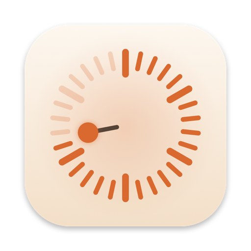

<p align="center"></p>

<h1 align="center">Pomly: Pomodoro Focus Timer for iPhone, iPad, Mac &amp; Apple Watch</h1>

<p align="center">
A calm, native Pomodoro timer. Drag the dial, focus, take a break.<br>
Live Activities, widgets, a Mac menu bar timer, an Apple Watch app and instant sync. Free, open source, no account, no tracking.
</p>

<p align="center">
<a href="https://github.com/tapariapurv/pomly/releases/latest"></a>


<a href="LICENSE"></a>
</p>

<p align="center"><a href="https://tapariapurv.github.io/pomly/"><b>Website</b></a> · <a href="#install">Install</a> · <a href="#features">Features</a> · <a href="https://tapariapurv.github.io/pomly/privacy.html">Privacy</a> · <a href="promo/">Promo video</a></p>

---

## Features

**Focus, simply**
- Drag around the dial to set 1–120 minutes, or tap 15 · 25 · 45 · 60. Start morphs into Pause and End in Liquid Glass.
- AlarmKit alarms ring through Silent mode and Focus, with **Take a Break** right on the alert.
- Label what you're working on (Study, Reading, Deep Work), long breaks every few sessions, and auto-start options.
- Full-screen minimal timer in black or white, portrait or landscape.

**iPhone & iPad:** Live Activity on the Lock Screen and in the Dynamic Island (three styles), Home Screen widgets that start sessions, Lock Screen and StandBy widgets, a Control Center and Action Button toggle, Siri and Shortcuts ("Start a focus in Pomly", "How much time is left in Pomly?"), iPad and iPhone Duo layouts.

**Mac**
- A menu bar timer with a live countdown ring. **Press the icon and drag away from it** to pick a length; release, name it, focus.
- **Set by Dragging** mode (no holding), a floating **mini timer** you can drag anywhere, and the **Timer** menu.
- Global shortcuts: <kbd>⌃⌥P</kbd> start/pause · <kbd>⌃⌥D</kbd> drag mode · <kbd>⇧⌘M</kbd> mini timer.

**Apple Watch:** an edge-to-edge dial with the Digital Crown, watch-face complications, and the iPhone Live Activity in the Smart Stack.

**Sync:** pair devices with a 6-character code. The timer and history follow you between iPhone, iPad, Mac and Watch in real time.

**Progress:** a daily goal ring, week and month charts, streaks, five color themes, light and dark.

## Install

### Mac
```bash
brew tap tapariapurv/pomly https://github.com/tapariapurv/pomly
brew install --cask pomly
```
or in one line:
```bash
curl -fsSL https://raw.githubusercontent.com/tapariapurv/pomly/main/scripts/install.sh | bash
```
or download **Pomly-macOS.zip** from [Releases](https://github.com/tapariapurv/pomly/releases/latest). Pomly isn't notarized yet, so open it the first time with right-click › **Open**. Requires macOS 26.

### iPhone, iPad and Apple Watch
Until it's on the App Store, pick one:
- **Sideload:** download **Pomly-iOS-unsigned.ipa** from [Releases](https://github.com/tapariapurv/pomly/releases/latest) and install it with [AltStore](https://altstore.io) or [Sideloadly](https://sideloadly.io), which sign it with your free Apple ID.
- **Build in Xcode (free Apple ID):** follow [Build from source](#build-from-source), open `Pomly.xcodeproj`, choose your team under *Signing & Capabilities* for each target, plug in your iPhone, and press Run. The Watch app installs with it.

Free Apple IDs re-sign every 7 days. AltStore does this automatically.

## Build from source
Requires Xcode 27 and [XcodeGen](https://github.com/yonaskolb/XcodeGen).
```bash
git clone https://github.com/tapariapurv/pomly && cd pomly
brew install xcodegen
xcodegen generate
open Pomly.xcodeproj
```
Schemes: **Pomly** (iPhone, iPad, Mac) and **PomlyWatch**.
- Tests: `xcodebuild -scheme Pomly -destination 'platform=iOS Simulator,name=iPhone 17 Pro' test`
- Release artifacts: `scripts/release.sh` builds them into `dist/`.

| Folder | What |
|---|---|
| `Pomly/` | App screens and the Mac menu bar |
| `Shared/` | Timer engine, model, intents, sync (app, widgets, Watch) |
| `PomlyWidgets/` | Widgets, Live Activity, Control |
| `PomlyWatch/`, `PomlyWatchWidgets/` | Apple Watch app and complications |
| `docs/` | Website (GitHub Pages) |
| `AppStore/` | Store listing, keywords, screenshot plan |
| `promo/` | Promo video source |

## Privacy
No ads, analytics, tracking or third-party SDKs. Sync is optional and uses an anonymous ID. Only your paired devices can read the timer and sessions, stored in Firebase over HTTPS without an SDK. Details: [privacy policy](https://tapariapurv.github.io/pomly/privacy.html).

## FAQ
<details><summary>Is it really free?</summary>Yes. MIT-licensed, with no in-app purchases.</details>
<details><summary>The Mac menu bar icon is missing.</summary>A menu bar manager (Bartender, Ice, Vorssaint) or the notch may be hiding it. Allow Pomly to show, or use <kbd>⌃⌥D</kbd> / the Timer menu.</details>
<details><summary>Does the alarm work in Silent mode?</summary>Yes, on iPhone and iPad through AlarmKit, once you allow alarms. Otherwise Pomly falls back to a notification.</details>

## License
[MIT](LICENSE) © 2026 Purv Taparia
